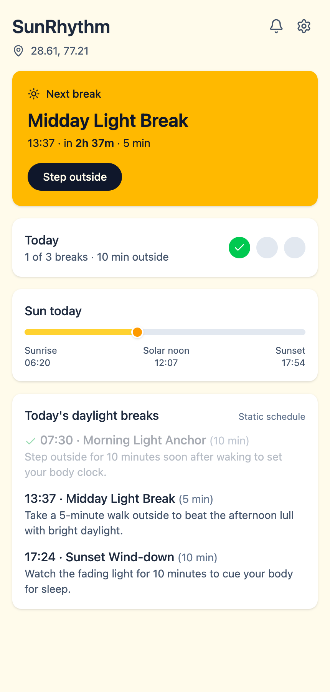
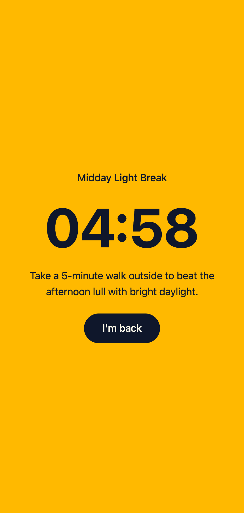
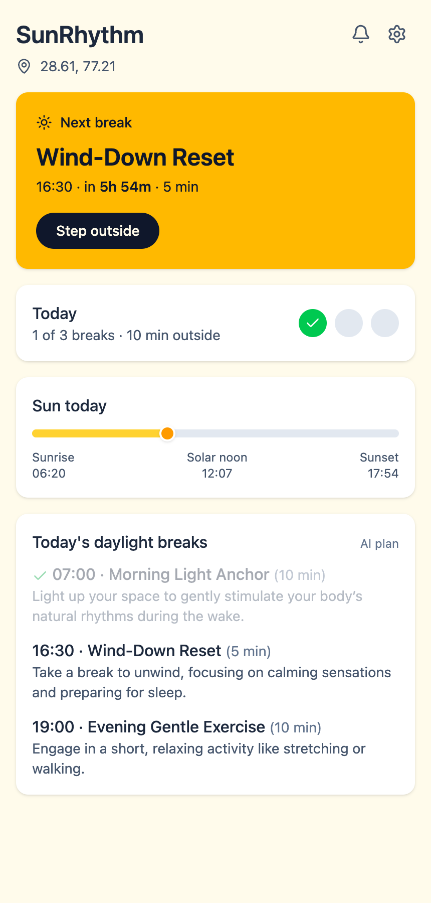

# ☀️ SunRhythm

**A privacy-first daylight coach for people who live on their screens.**
SunRhythm works out when the sun is up where you are, schedules three short outdoor breaks around it, and turns your screen into one big countdown when it's time to go outside.

Everything runs in your browser. The only network call the app can ever make is to an [Ollama](https://ollama.com) instance on your own machine.

<p align="center">
  
  
  
</p>

## Why

Ten hours under LED light means afternoon crashes and late bedtimes. Habit trackers don't fix that because they demand constant manual input. SunRhythm asks for nothing: open it, and it already knows where the sun is and what to do next.

## Features

- **Automatic solar times.** Uses your browser location to compute dawn, sunrise, solar noon, sunset and dusk on-device with [`suncalc`](https://github.com/mourner/suncalc).
- **Three daylight breaks a day.** A morning light anchor, a midday reset and a sunset wind-down, timed to today's sun and your wake time.
- **Optional AI plan.** If a local Ollama model is running, it writes a personalised version of the three breaks. If not, you get the built-in schedule instantly. You never see an error.
- **Step Outside mode.** One tap gives a full-screen mm:ss countdown with a single "I'm back" button.
- **Gentle reminders.** A synthesized chime, a vibration (where supported) and a banner when a break opens. Each break reminds once per day, and one tap mutes everything.
- **Automatic daily log.** Finished breaks and minutes outside are recorded for you, with no typing, and reset each day.
- **Optional Settings.** Wake and sleep times and a manual latitude/longitude override. Defaults (07:00 / 23:00) work on first launch.

## Privacy

| Data | Where it lives | Leaves your device? |
|------|----------------|---------------------|
| Location | Browser `localStorage` | No |
| Wake and sleep times | Browser `localStorage` | No |
| Daily log and cached plan | Browser `localStorage` | No |
| AI prompt (wake/sleep times, sunrise/sunset only) | Sent to `localhost:11434` | Only to your own machine |

There is no backend, no analytics, no accounts and no cloud AI. Coordinates and place names are never put in the AI prompt. You can check this in your browser's Network tab: the only requests are to `localhost`.

## Quick start

Requires Node 20+.

```bash
git clone https://github.com/Parth-G27/SunRhythm.git
cd SunRhythm
npm install
npm run dev
```

Open the printed URL and allow location access. If you decline, the app shows a labelled New Delhi default and a "Use my location" button.

### Optional: turn on the AI plan

Install [Ollama](https://ollama.com), pull any small chat model and start the server:

```bash
ollama pull gemma3:1b
ollama serve
```

SunRhythm asks Ollama which models are installed and uses `gemma3:4b`, `gemma3:1b` or `phi3` if present, otherwise the first installed chat model. The header of the break list shows **AI plan** when the model's answer was used and **Static schedule** otherwise.

- Small models are imperfect. Replies are validated (exactly three breaks, valid times inside your waking hours), retried once, and dropped in favour of the static schedule if they still fail. A larger model such as `gemma3:4b` is steadier.
- A good plan is cached for the day, so reloads don't re-run the model. To regenerate, clear the `sunrhythm:plan` key in your browser's localStorage.
- If your browser blocks the request (CORS), start Ollama with `OLLAMA_ORIGINS="http://localhost:5173"`.

## How it works

```
 browser location ─► solar times (suncalc) ─► static schedule ──────────┐
                                    │                                   ▼
                                    └─► prompt (times only) ─► local Ollama ─► validate ─► AI plan
                                                                  (fails/slow/invalid → keep static)
```

The static schedule is always computed first and shown immediately. The AI plan replaces it only if it arrives within 20 seconds and passes validation.

| Break | When |
|-------|------|
| Morning light anchor | 30 min after wake time (never before sunrise), 10 min |
| Midday light break | 90 min after solar noon, 5 min |
| Sunset wind-down | 30 min before sunset, 10 min |

A break is "open" from its start time until 30 minutes later. In that window the dashboard says "Time to step outside" and the reminder can fire.

## Tech stack

React 18 · Vite · Tailwind CSS v4 · lucide-react · `suncalc` · Web Audio and Vibration APIs · Vitest. No state library: each concern is a small service plus a hook.

```
src/
├── components/   Dashboard, NextBreak, SolarCard, StepOutside, SettingsModal, …
├── hooks/        useLocation, useSchedule, useReminder, useDailyLog, …
├── services/     solar, schedule, ollama, reminder, log, profile, location
└── lib/          storage (safe localStorage helpers)
```

## Development

```bash
npm run dev      # start the app
npm test         # 44 unit tests (pure logic, stubbed Ollama)
npm run build    # production build
```

The project was built spec-first with [GitHub Spec Kit](https://github.com/github/spec-kit). The project principles are in [`.specify/memory/constitution.md`](.specify/memory/constitution.md), and every feature has a spec, plan and task list under [`specs/`](specs/).

## Known limitations

- Reminders only work while the app is open in a tab. Background alerts would need a push server, which this project deliberately doesn't have.
- Browsers block sound until you interact with the page, so the chime may be skipped on a cold load. The banner and vibration still appear.
- Manual locations have no place-name search, because that would need a network lookup. Enter coordinates instead.
- Sun times for a manual location in another time zone are shown in your device's time zone.
- Weather is not used, since it would need an external service.

## Built for

[Hacktoberfest Open-Source AI Challenge, Week 1: Touch Grass](https://dev.to/challenges/hacktoberfest-week1-2026-10-05).
